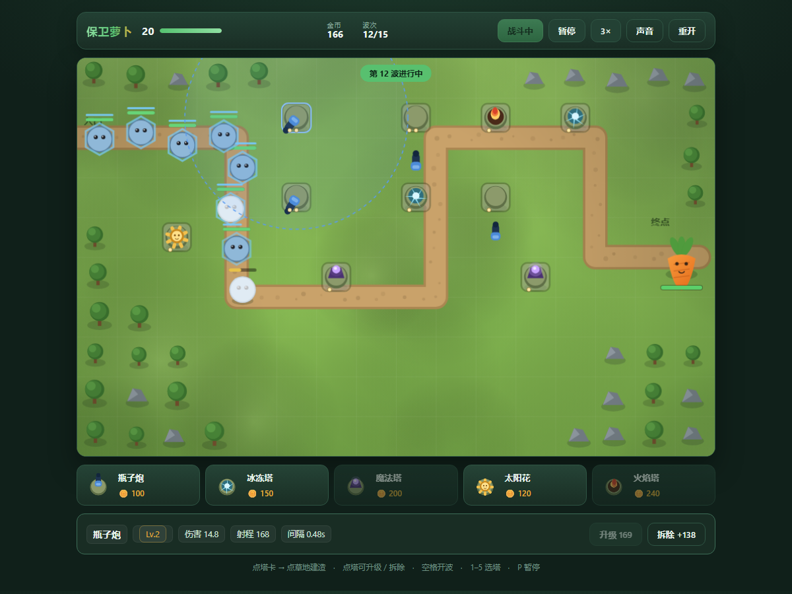

# 保卫萝卜 · 网页版

经典塔防的浏览器实现：建塔、升级、挡住 15 波怪物，别让它们碰到萝卜。
**纯前端、零依赖、无构建步骤**——所有画面都是 canvas 现画的，仓库里没有一张图片。

**在线试玩 → [algsn1386.github.io/carrot-defense](https://algsn1386.github.io/carrot-defense/)**



## 为什么做这个

原版最上瘾的地方是**资源与地形的双重约束**：金币有限、好位置有限，你得判断哪一段路最值得投资。这个版本保留了这点，但把一局压缩到 10 分钟左右（原版一关动辄半小时），并把难度曲线用仿真调过——不是凭感觉拍的数值。

## 玩法

- 点下方卡片选塔 → 点空地建造（绿色可建，红色不可建）
- 点已建好的塔可升级（最高 3 级）或拆除（返还 60%）
- 每波之间有 12 秒布防时间，也可以点「立即开战」提前开始
- 怪物走到终点会扣萝卜生命，生命归零即失败；撑过 15 波即通关

| 操作 | 快捷键 |
|---|---|
| 选塔 | `1` `2` `3` `4` `5` |
| 立即开战 | `空格` |
| 暂停 | `P` |
| 取消选择 | `Esc` / 右键 |

## 防御塔

| 塔 | 造价 | 伤害 | 射程 | 间隔 | 特点 |
|---|---|---|---|---|---|
| 瓶子炮 | 100 | 9 | 150 | 0.55s | 射速快，单体稳定输出 |
| 冰冻塔 | 150 | 5 | 132 | 1.15s | 命中范围内减速 45%，持续 2.2s |
| 魔法塔 | 200 | 22 | 165 | 1.45s | 范围溅射（半径 72），清小怪快 |
| 太阳花 | 120 | — | — | — | 每 7 秒产 16 金币，不攻击 |
| 火焰塔 | 240 | 7 | 128 | 0.35s | 附加每秒 9 点灼烧，克制高血量 |

升级（2/3 级）：伤害 ×1.65、射程 +18、间隔 ×0.88，造价约为原价 0.9 倍 / 1.3 倍。

## 怪物与波次

| 怪物 | 生命 | 速度 | 赏金 | 特性 |
|---|---|---|---|---|
| 小怪 | 44 | 56 | 9 | 基础单位 |
| 快跑怪 | 30 | 104 | 8 | 血薄但很快 |
| 铁甲怪 | 150 | 40 | 16 | 每次受击减伤 4 |
| 护盾怪 | 70 + 70 盾 | 52 | 18 | 护盾先吃伤害 |
| 首领 | 900 | 32 | 130 | 减伤 3，扣 5 点生命 |

15 波，第 5/10/15 波是首领波。每波怪物生命按 `1 + 0.22 × (波次 - 1)` 放大。

## 数值是仿真调出来的

这套数值不是拍脑袋定的。逻辑层（`js/game.js`）不依赖 DOM 和 canvas，所以可以直接在 Node 里跑完整对局验证平衡：

| 策略 | 结果 | 说明 |
|---|---|---|
| `none`（不建塔） | 第 2 波失守 | 失败路径正常 |
| `greedy`（见塔就铺，从不升级） | 第 11 波失守 | 铺塔流打不过后期 |
| `quality`（少而精，先升满核心塔） | 通关，剩余 16/20 生命 | 正确策略能赢，但不是躺赢 |

三轮跑下来确认了：**策略梯度成立**（乱铺会输、精选能赢），而且终局金币只剩 54——经济也是紧的，没有出现后期钱花不完的失衡。

仿真脚本用贪心策略自动买塔/升级，跑的是真实游戏循环（`update(state, dt)`），不是简化模型。

## 代码结构

```
index.html      页面骨架
styles.css      全部界面样式
js/config.js    地图、路径、塔/怪物/波次数值
js/game.js      纯逻辑：寻路、攻击、伤害、波次、经济
js/render.js    canvas 渲染：地图、塔、怪物、投射物、粒子
js/ui.js        canvas 尺寸、输入映射、HUD、商店、主循环
```

### 几个值得说明的取舍

**1. 逻辑与渲染彻底分离**
`game.js` 里没有一行 DOM 或 canvas 代码，只接受 `(state, dt)`。代价是渲染要自己从 state 里取数据，收益是这个游戏的核心玩法可以被自动化测试和仿真验证——上面那张表就是这么来的。

**2. 整个游戏没有一张图片**
地图、塔、怪物、特效全部是 canvas 基本图形组合出来的。好处是仓库极小、任何分辨率都不糊、改配色不用重新导出资源。

**3. 逻辑坐标固定 960×600，实际分辨率跟随 DPR**
所有绘制用逻辑坐标，`ctx.setTransform` 统一缩放。因此同一套坐标既能适配手机窄屏，也能在高分屏上保持清晰。

**4. 波次是数据，不是代码**
`config.js` 里每波就是一组 `{type, count, gap, delay}`。想加一波或调难度，改数组即可，不需要动逻辑。

**5. 状态机而不是布尔标志**
`phase` 只有 `build / wave / won / lost` 四个值，每帧根据它决定跑不跑生成、判不判胜负。避免了「暂停时怪物还在动」这类经典 bug。

## 本地运行

ES 模块不能用 `file://` 打开，起一个静态服务器即可：

```sh
python -m http.server 8000
# 打开 http://localhost:8000
```

## 已知限制

- 只有一张地图（做多地图需要额外设计关卡数据）
- 没有音效
- 没有存档：一局打完就结束，刷新即重开
- 怪物沿固定路径走，不会绕路或攻击防御塔

## License

MIT © 2026 ALGSN1386
