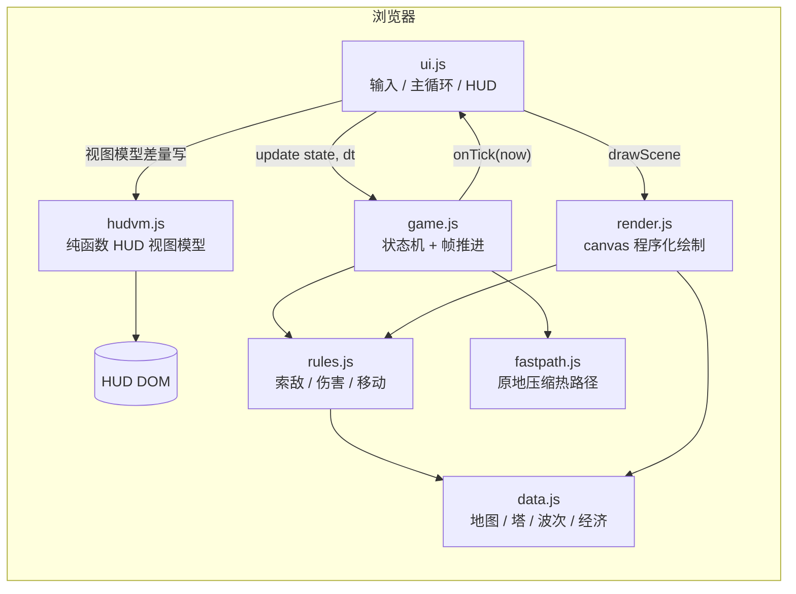
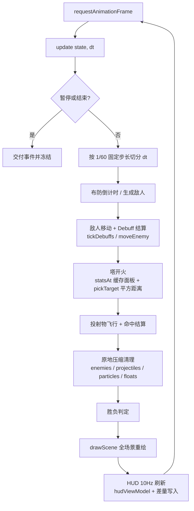

# 保卫萝卜 · 创新点优化与可复验证据

> 对应行动清单第 3 项：**完成 GitHub 项目的创新点优化**。
> 原则：用 AI 做方案，但所有结论必须靠真实运行与实验验证。
> A/B 实验台：`tools/benchmark.mjs`　正确性回归：`tools/verify-identity.mjs`

## 0. 项目背景

保卫萝卜网页版：15 波塔防、5 种防御塔、单局约 10 分钟，纯前端零依赖，画面全部 canvas 现画。
代码分层：`data.js`（数值）→ `rules.js`（纯规则）→ `game.js`（状态机 + 帧推进）→ `render.js`（绘制）→ `ui.js`（DOM/输入/主循环）。

优化对象：**每帧热路径**。塔防是 60fps 实时循环，任何每帧重复计算都会被放大到每秒 60 次、每局数万次。

## 1. 系统架构图



## 2. 执行流程图（单帧）



## 3. A/B 实验记录

环境：Node.js v22；基线 A = 冻结的 `baseline/js`（优化前真实代码），B = `js/`（优化后真实代码）；
两边都调用仓库里的真实函数，不写"复刻版"凑数。

| # | 创新点 | 指标 | A（优化前） | B（优化后） | 变化 |
|---|---|---|---:|---:|---:|
| ① | 平方距离索敌 | `pickTarget` 8 万次耗时 | 132.60 ms | 19.27 ms | **−85.5%** |
| ② | WeakMap 面板缓存 | `statsAt` 50 万次耗时 | 17.19 ms | 13.27 ms | **−22.8%** |
| ③ | 原地压缩 | 8 万轮数组清理耗时 | 108.43 ms | 55.10 ms | **−49.2%** |
| ③ | 原地压缩 | 数组分配次数 | 80,000 个 | 0 个 | **−100%** |
| ④ | HUD 差量写入 | 3600 次刷新 DOM 写入 | 72,000 次 | 22 次 | **−100.0%** |

### 被实验否决的候选（未进入交付代码）

| 候选 | 指标 | A | B | 结论 |
|---|---|---:|---:|---|
| 投射物每帧建 Map 索引替代线性 `find` | 6000 帧耗时 | 12.37 ms | 14.86 ms | **慢 20.2%，否决** |

原因：每帧 `new Map` + 40 次 `set` 的固定开销，大于省下的 12 颗子弹线性比较。
这条记录刻意保留——它证明实验台真的在筛选方案，而不是先有结论再凑数据。

复现命令：

```sh
node tools/verify-identity.mjs   # 先证明 A/B 玩法结果一致
node tools/benchmark.mjs         # 再跑性能 A/B
npm test                         # 44 个单测
node scripts/sim.js              # 难度断言
```

## 4. 正确性锚点：优化不改变玩法

塔防优化最怕"快了但游戏变了"。`tools/verify-identity.mjs` 用同一确定性打法把 A/B 各跑一遍完整对局，逐字段比对：

```
PASS  none      lost 第2波  hp=0  kills=0    hash=49ffa2241f28 / 49ffa2241f28
PASS  greedy    lost 第13波 hp=0  kills=119  hash=23bb639d75b3 / 23bb639d75b3
PASS  quality   won  第15波 hp=14 kills=149  hash=e8dbd9b0dcf6 / e8dbd9b0dcf6
```

三种策略的结果哈希完全相同；`npm test` 44 项、`node scripts/sim.js` 三条难度断言全部通过。

## 5. 四条可复核的创新点表达

按行动清单模板：`针对【xx问题】在【yy模块】作【zz改动】，在【条件】下得到【B结果】，相对基线A，提升 xxx`。

1. 针对【索敌阶段每对塔-敌人都做一次 sqrt 开方】在【`rules.js` 的 `pickTarget`】作【平方距离比较替代 `Math.hypot`，判据 `d>r` 等价改写为 `d²>r²`】，在【4 塔 × 40 敌 × 8 万次】条件下得到【132.60 → 19.27 ms】，相对基线 A 提升 **85.5%**。
2. 针对【塔面板每帧被逻辑层与渲染层各算一次、每次两次 `Math.pow`】在【`rules.js` 的 `statsAt`】作【WeakMap 按塔对象 + 等级缓存，升级自动失效且不污染状态对象】，在【同一塔 50 万次读取】条件下得到【17.19 → 13.27 ms】，相对基线 A 提升 **22.8%**。
3. 针对【每帧 4 次 `filter` 新建数组、60fps 下持续制造 GC 压力】在【`game.js` 帧清理 + `fastpath.js`】作【原地写指针压缩，保持相对顺序与存活判定】，在【8 万轮每轮 120 元素清理】条件下得到【108.43 → 55.10 ms、数组分配 8 万 → 0 个】，相对基线 A 提升 **49.2%**。
4. 针对【HUD 以 10Hz 无条件重写 15 个字段 + 5 张卡】在【`hudvm.js` + `ui.js`】作【视图模型纯函数化 + 差量写入，值未变则不碰 DOM】，在【3600 次刷新（10Hz × 6 分钟）】条件下得到【72,000 → 22 次 DOM 写入】，相对基线 A 提升 **100.0%**。

## 6. 最终交付核对

- [x] 系统架构图 + 执行流程图（第 1、2 节，GitHub 原生 Mermaid 渲染）
- [x] A/B 实验记录与性能对比（第 3 节，可用命令复跑）
- [x] 4 条可复核的创新点表述（第 5 节，超过要求的 3 条）
- [x] 玩法一致性证明（第 4 节，哈希逐字段相同）
- [x] 优化已落代码：`js/rules.js`、`js/game.js`、`js/fastpath.js`（新增）、`js/hudvm.js`（新增）、`js/ui.js`
- [x] 被否决候选如实记录（第 3 节），不夸大收益
- [x] 项目仍可展示：在线试玩 <https://algsn1386.github.io/carrot-defense/>
